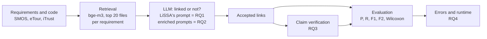

# Project flow

Where the project stands, what comes next, and how each step is done.
Last updated: 15 November 2026, about 18:30 UTC.

## 1. The pipeline



- Steps A–D are LiSSA itself (RQ1). RQ2 changes only the prompt in C; RQ3 adds E. Links are scored with and without E.
- Requirements are split per project into 20% **dev** (choices are made here) and 80% **test** (reported once, after freezing).

## 2. Where we are

| Stage | Status | Evidence |
|---|---|---|
| Data, LiSSA build, Ollama setup | Done | `rq1-report.md`, "Validity checks" |
| Harness reproduces LiSSA exactly | Done | `harness/data/check_rq1.md`: ALL CHECKS PASSED |
| RQ1 on Colab L4 (both models, KISS, chain-of-thought, retrieval only) | Done 15 Nov 13:32 UTC | `LiSSA-RATLR-V2/lissa/results-local/rq1/` |
| RQ1 on Rahul's laptop | Running | Rahul's machine |
| Dev split and frozen prompt texts | Done 14 Nov | `harness/data/split.json`, `harness/prompts/` |
| RQ2/RQ3 dev passes (pipeline v2) | Running since 15 Nov 14:42 UTC | `harness/runs/pipeline-dev.log` |
| — Qwen: baseline, definition, summary | Done | `harness/runs/*qwen*__dev` |
| — Qwen: project, examples | Running / waiting | |
| — Llama: baseline + 4 variants | Waiting | |
| — Round-2 combination, both models | Waiting | |
| — Repeatability check (50 pairs per model) | Waiting | |
| — Claim verification on dev, τ choice | Waiting | |
| Test slice | Not started | |
| RQ4 error coding, laptop timings | Not started | |
| Final report | Not started | |

The dev passes should end around **16 Nov, 13:00–15:00 UTC**. Colab ends a session after 24 hours (about 14:18 UTC on 16 Nov), so verification may need one resume (see section 6).

## 3. What's next, and how

### Step 1. Finish the dev passes (automatic)

- **What:** the pipeline continues by itself in Colab. An hourly check reads its log from Google Drive and resumes it if the session ends.
- **Done when:** the log ends with `ROUND 2 DEV DONE`, followed by a summary per model compared with GPT-4o's dev F1 (0.385; 0.385–0.394 over LiSSA's three seeds).
- **Then:** shut down the Colab runtime so it stops using compute units.

### Step 2. Freeze the dev choices (both of us, about 16 Nov)

The rules were fixed before any result was seen:

| Choice | Rule |
|---|---|
| Best prompt per model | Highest average F1 on dev with strict parsing, among the baseline, the four variants and the round-2 combination |
| τ | Highest average F1 of the baseline's dev verification, from {0.2, 0.4, 0.6, 0.8, 1.0} |
| Parsing | Strict (LiSSA's rule) for every choice and result, as the proposal says ("exactly as LiSSA does"). Tolerant only in RQ4 (step 6) |
| Verification details | "Unclear" counts as not supported; a link without claims has share 0 |
| Unlinked requirements | Left out of the Wilcoxon tests |

- **How:** write `harness/FROZEN.md` with the chosen prompt per model, τ, the date, and the SHA-256 hashes of the prompt files, `split.json` and the harness code. Commit it **before** any test-slice call.
- **Done when:** both of us have approved `FROZEN.md`.

### Step 3. Run the test slice once (Colab, about 17–21 Nov)

- **What runs, per model:**
  - classification: baseline, the four variants, and the combination if it is the best prompt;
  - verification: baseline and best prompt (for the 2×2).
- **Size:** 205 requirements × 20 = 4,100 pairs per configuration, about 4 times dev. Estimate: **80–90 L4 hours**, about 4 Colab sessions, about 155–175 compute units.
- **How:**
  - A test version of `colab/lissa_pipeline2.sh` runs the slice in chunks of requirements, using `run.py --slice test --limit N` with N = 10, 20, 30, … The answers are saved, so each larger N only asks about the new requirements.
  - Within a chunk, every configuration runs on the same requirements, so all answers for a given requirement come from the same session. The Wilcoxon tests compare exactly these per-requirement pairs.
  - Try it first on a laptop with `--dry-run` and a 2-requirement chunk.
- **Done when:** every configuration has `decisions.csv` and, where planned, `verify-strict/metrics.json` for the full test slice.

### Step 4. Statistics and tables (Rahul leads, by 28 Nov)

```bash
python3 harness/analyze.py --parser strict test harness/runs/baseline__<model>__colab-l4__test \
    harness/runs/<variant>__<model>__colab-l4__test ... "harness/runs/<best>__<model>__colab-l4__test@tau=<τ>"
```

- Two-sided Wilcoxon signed-rank test on per-requirement F1, α = 0.05, Holm-corrected; effect size reported.
- Tables: P, R, F1, F2 per project and averages, for every configuration on test, all with strict parsing (LiSSA's rule).

### Step 5. RQ1, final tables (both)

- Decide which RQ1 run is the main result (recommended: Rahul's laptop run, which matches the proposal; the Colab run as a second run).
- Compare the two runs: link overlap and F1 difference per configuration. This is our measured run-to-run variability.

### Step 6. RQ4, errors (both, by 5 Dec)

- **Sample:** from the best test configuration before and after verification, three pools: false links kept, false links removed, correct links lost. About 33 per pool, drawn with a fixed seed. If a pool is small, code all of it and fill from the others (up to 100).
- **Coding:** start codes: lexical overlap only, interface or helper class, invented identifier, gold-standard gap, input cut short, **missing answer tag**. Code 20 together, then 80 independently. Report Cohen's κ. A first codebook can be drafted from dev errors only.
- **Missing answer tag (counted, not sampled):** for every configuration, count the answers without the `<trace>` tag, and score the same answers once more with the tolerant rule (`--parser tolerant`). The difference from the strict F1 is what this error type costs. This is the **only** place tolerant scores appear, because the proposal fixes all other scoring to LiSSA's rule.

### Step 7. RQ4, runtime on a laptop (Rahul, after his RQ1 run)

- **Sample:** about 10 requirements per configuration, stratified by project, fresh calls on the M5 Pro, both models, plus verification of their accepted links. About 6 hours, overnight.
- **How:** `run.py` and `verify.py` with `--limit` on Rahul's Mac. Answers are saved per chip, so the Mac makes its own fresh calls.
- **Report:** time per requirement, median and IQR, without model loading and saved answers. Tokens per requirement come from the saved Colab answers.

### Step 8. Report (both, by mid-December; hard deadline 21 Dec)

- 6–8 pages plus references, empirical SE reporting style; the code is submitted with it.
- **Writing split, as in the proposal:** Prabhjot writes the approach and results; Rahul writes the data, evaluation method and threats to validity; both edit everything.
- Use [`reports/proposal-compliance.md`](../reports/proposal-compliance.md) for the setup and threats wording.

## 4. Timeline

| Dates | Step | Proposal milestone |
|---|---|---|
| 14–15 Nov | RQ1 on Colab (done) | RQ1 by Nov 14 (one day late) |
| 15–16 Nov | Dev passes (running) | |
| 16 Nov | Freeze dev choices | |
| 17–21 Nov | Test slice | RQ2–RQ3 by Nov 28 |
| 22–28 Nov | Statistics, tables, laptop timings | |
| 29 Nov–5 Dec | RQ4 error coding, κ | Analysis by Dec 5 |
| 6–14 Dec | Report writing, code package | Report by mid-December |
| 21 Dec | Hard deadline (late reports get no credit) | |

## 5. Rules that must not change

- No test-slice result is looked at before the dev choices are frozen and committed.
- Every RQ1–RQ3 result is scored with LiSSA's strict rule; tolerant scores appear only in RQ4.
- Same models (digests in `run.json`), Ollama 0.40.2, temperature 0, seed 133742243, context 16,384, answers capped at 4,096 tokens.
- bge-m3 embeddings only; the top-20 candidates from RQ1 (`harness/data/candidates-rq1.json`).
- One request at a time on the GPU (`OLLAMA_NUM_PARALLEL=1`); no other speed-ups that change run conditions.
- Answers from different chips are never mixed in one run.
- Every configuration tried on dev is listed in the report.

## 6. Risks and what we do about them

| Risk | What we do |
|---|---|
| Colab ends a session after 24 hours | The pipeline saves to Drive every 2 minutes and skips finished steps. Resume: open the notebook with an L4 runtime, run cells 1–4, the hash-check cell, then `!bash /content/drive/MyDrive/lissa_start2.sh` (details in [`colab/README.md`](../colab/README.md)). |
| Answers differ between sessions | Dev comparisons in one session; test split by requirement; the variability is measured and reported. |
| Qwen leaves out the `<trace>` tag | Results stay on LiSSA's strict rule, as the proposal requires; the tag errors are counted and costed in RQ4. |
| Verification takes longer than estimated | It only removes links and can continue in a new session; verify only the baseline and the best prompt on test. |
| Compute units | About 1,320 units left on 15 Nov; the whole plan needs about 250. |
| The test runs slip | One week of slack before 28 Nov; the report can start on dev and RQ1 results. |
